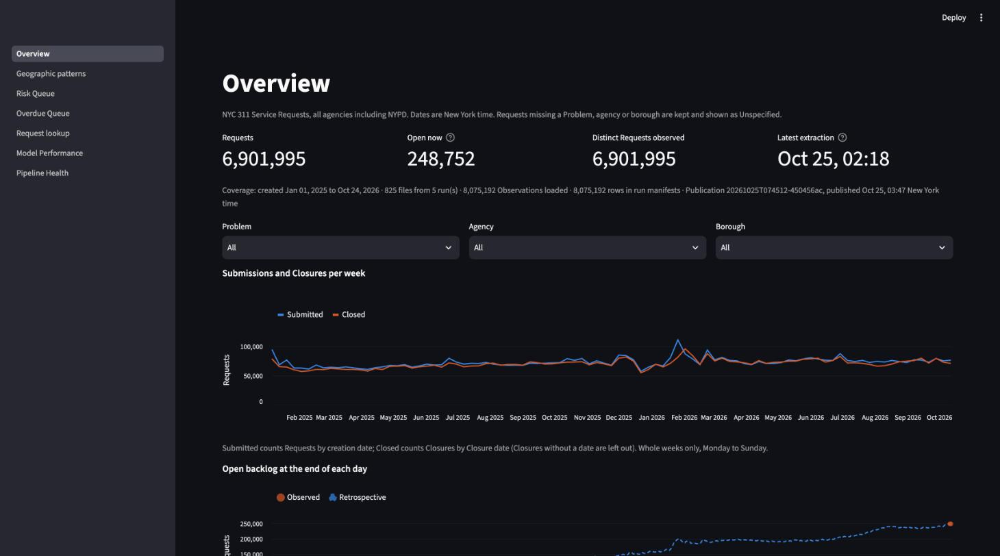
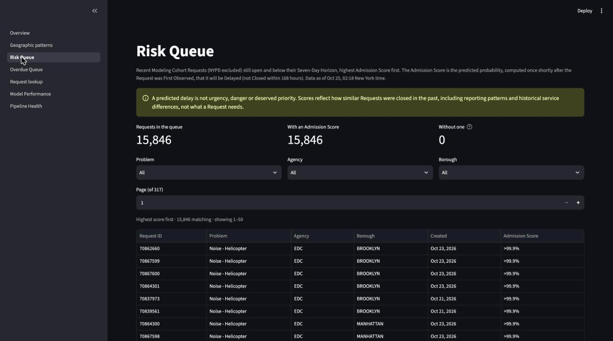
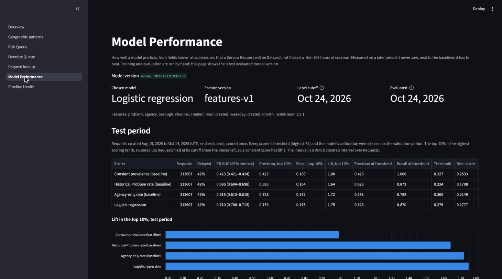
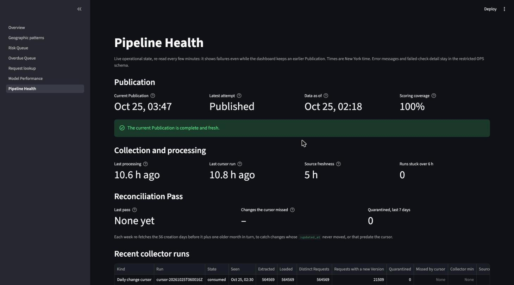

# NYC 311 Signal

An automated daily pipeline and dashboard over NYC 311 Service Requests (2025-01 onward, all agencies, unsampled). It collects every new and changed Request, keeps an exact history of how each one changed, publishes validated analytics daily, and gives each new Request a Delayed probability: the chance it is not Closed within seven days. The model is evaluated honestly against simple baselines.

Vocabulary (Service Request, Observation, Request Version, Label, Admission Score, Publication…) is defined in [GLOSSARY.md](GLOSSARY.md). The design and its reasoning are in [instruction.md](instruction.md), with decisions in [docs/adr/](docs/adr/).



## Architecture

```
NYC Open Data (Socrata)
   │  daily change cursor (:updated_at − 6 h), weekly Reconciliation Pass, one-off backfill
   ▼
Collector (Lambda / ECS Fargate) ── immutable gzip NDJSON Observations + run manifests ──► S3
   │                                                                                       │
   │                                                     Snowpipe (data/daily) · bulk COPY │
   ▼                                                                                       ▼
Snowflake  RAW ─► readiness gate (manifest reconciles?) ─► quarantine ─► Request Versions ─► Current Requests
              ─► OPS.PUBLISH(): analytics, Labels, frozen feature snapshots, Admission Scores, Risk Queue
                 ─► 22 checks ─► move the current-Publication pointer (or hold, keeping the last one)
   │                                                     │
   ▼                                                     ▼
Streamlit dashboard (read-only role, APP views)     Monitor Lambda ─► CloudWatch metrics + alarms ─► SNS email
```

- **Change capture.** A daily cursor pass on the source's `:updated_at`, with a 6-hour overlap, fetches every Request that changed. A weekly Reconciliation Pass re-fetches older creation dates and counts the changes the cursor missed. Files are immutable and their identities deterministic, so a retry never duplicates or overwrites anything.
- **History, not just the Current Request.** Identical Observations collapse into Request Versions. An older Observation arriving late never overwrites a newer state. Malformed rows are quarantined with a reason, never dropped.
- **Publications.** Every output (charts, queues, scores) is built under one `publication_id` and checked. It becomes visible only if every check passes. A failure keeps the previous Publication, with a stale-data notice.
- **Model.** Logistic regression on fields known at submission (Problem, agency, borough, channel, creation hour, weekday, month), evaluated chronologically against baselines.
  - The model is scored in SQL from its registered weights. Each eligible Request is scored once, from features frozen when it was first eligible, and the score is never recomputed.
  - NYPD is outside the Modeling Cohort ([ADR 0001](docs/adr/0001-exclude-nypd-from-modeling-cohort.md)).
- **Infrastructure.** AWS (us-east-2) is managed by Terraform ([infrastructure/terraform](infrastructure/terraform/README.md)). Snowflake objects are managed by reviewed, never-edited migrations ([snowflake/migrations](snowflake/migrations/)). CI runs typechecks, tests, image builds and `terraform validate`.

## Dashboard

| Page | What it shows |
|---|---|
| Overview | Submissions and Closures per week, the open backlog (counts saved each day beside a retrospective reconstruction), and data coverage |
| Geographic patterns | Borough and Problem comparisons, and an H3 map with at least 20 Requests per cell (no pinpoint locations) |
| Risk Queue | Open, recent Modeling Cohort Requests by Admission Score. Six fields only, with a note that predicted delay is not urgency |
| Overdue Queue | Requests observed open past seven days, NYPD included. A fact, kept apart from predictions |
| Request lookup | One Request as the current Publication saw it: selected fields, freshness, score provenance |
| Model Performance | The test period against three baselines, the splits, slices with sample sizes, Label counts, limitations |
| Pipeline Health | Live run metrics, Publication attempts, source freshness, the Reconciliation Pass, quarantine |

| | |
|---|---|
|  |  |
|  | |

## Measured results (dev, 2026-10-25)

- **Data:** 6,901,995 Current Requests created 2025-01-01 to 2026-10-24, from 8.08 million Observations; 0 quarantined. 248,752 open, of which 221,930 are Overdue.
- **Labels:** 3.68 million labeled Modeling Cohort Requests, 35% Delayed. Duplicate Closures are 7.2% of them (10.7% of the 0s, 0.7% of the 1s).
- **Model, test period** (approved model `model-20261025T035838`; Requests created 2026-08-19 to 2026-10-14, n = 313,607, 42.3% Delayed). The model beats the agency-only baseline clearly, but adds little over the historical-Problem baseline: most of the signal is the Problem itself.

| Scorer | PR-AUC (95% interval) | Lift, top 10% | Brier |
|---|---|---:|---:|
| Constant prevalence | 0.423 | 1.00 | 0.253 |
| Agency-only rate | 0.616 (0.613–0.618) | 1.72 | 0.215 |
| Historical Problem rate | 0.696 (0.694–0.698) | 1.64 | 0.180 |
| **Logistic regression** | **0.710** (0.708–0.713) | **1.75** | **0.178** |

- **Scoring:** 21,287 Requests have an Admission Score, and the current Risk Queue holds 15,846, all scored. A Publication takes about 2 minutes.

Full detail: [docs/model-card.md](docs/model-card.md). One Request traced from S3 to the dashboard, including a later Closure that leaves its score intact: [docs/end-to-end-trace.md](docs/end-to-end-trace.md).

## Setup

Requires Python 3.13 and [uv](https://docs.astral.sh/uv/). A Snowflake account with key-pair auth and an AWS account are needed for anything past the offline tests.

```sh
uv sync                                                  # dependencies from uv.lock
cp .env.example .env                                     # then fill in Snowflake and AWS settings
git config core.hooksPath .githooks                      # typecheck + offline tests before each commit
uv run pytest                                            # offline tests; Snowflake tests skip without credentials
uv run --env-file .env pytest                            # everything, against NYC311_DEV_TEST
uv run --env-file .env python -m warehouse.migrate       # apply migrations to NYC311_DEV
uv run --env-file .env streamlit run dashboard/app.py    # the dashboard, locally
```

One-time Snowflake setup is `snowflake/setup_dev.sql` (`setup_prod.sql` for production). The AWS side, including secrets, the daily collector, the backfill, monitoring, production and continuous deployment, is in [infrastructure/terraform/README.md](infrastructure/terraform/README.md). Model work is run by hand: `python -m ml.train` evaluates and registers a model, and `python -m ml.promote <version>` approves it.

## Operating it

- **Alerts and what to do:** [docs/runbook.md](docs/runbook.md).
- **Costs and how to stop everything:** [docs/cost-and-shutdown.md](docs/cost-and-shutdown.md).
- **Recovery drill:** [docs/recovery-drill.md](docs/recovery-drill.md).

## Limitations

- **The Label is administrative.** A Closure, including a Duplicate Closure, does not mean the problem was fixed. Seven days is a project threshold, not a city service-level agreement.
- **Retrospective evaluation is approximate.** Features come from each Current Request, whose agency, Problem or borough the source may have corrected since submission. Label versions are only recorded from 2026-10-24, so earlier splits could check only that a Label had matured. Prospective evaluation on the frozen first-observed inputs, scored since 2026-10-25, is the trustworthy measure as Labels mature.
- **NYPD is excluded from the model** ([ADR 0001](docs/adr/0001-exclude-nypd-from-modeling-cohort.md)), but is included in analytics and the Overdue Queue.
- **Date-Only Closures** (most DOB Closures) are judged by calendar day; one on the horizon day has no Label.
- **Associations, not causes.** Scores reflect reporting patterns and historical service differences. Within some agencies (DEP) the model ranks worse than chance.
- **Not deployed yet.** The production environment, the public URL and continuous deployment are written and validated but not applied. Applying them needs a domain and spends money (about $41 a month).
