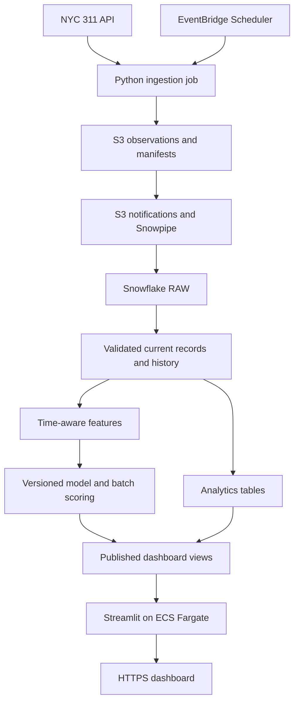
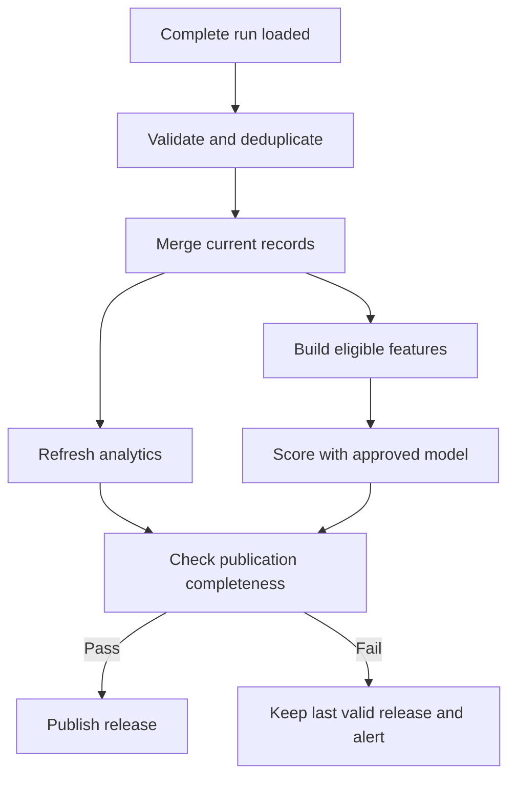

# NYC 311 Intelligence: End-to-End AWS + Snowflake Project

**Project owner:** Hari Acharya  
**Document:** System design and implementation guide  
**Prepared:** October 22, 2026  
**Status:** Proposed architecture. This document describes what to build; it does not claim that infrastructure has been deployed or that a model has achieved any particular performance.

## 1. The project in plain language

Build a system that collects NYC 311 service requests, keeps their information up to date, analyzes closure patterns, and predicts which newly submitted requests will not be closed within seven days. Present the results through a deployed web dashboard.

311 requests include issues such as noise, heating problems, garbage, potholes, and broken streetlights. The project helps answer:

- Which new requests are likely to miss the seven-day closure threshold?
- Which boroughs and complaint categories have longer closure times?
- How does the open backlog change over time?
- Which requests could an analyst review first?
- How reliable are the predictions on later, unseen data?

The predicted outcome is **administrative closure delay**. A closed request does not necessarily mean the physical problem was fixed. Seven days is a project-defined threshold, not a universal city service deadline.

The main deliverable is a working application supported by an automated data pipeline. A notebook is useful during development, but the finished project must refresh data and publish predictions without someone manually running cells.

## 2. Scope and definition of success

### Initial version

Start with approximately 100,000 historical records spanning enough time to create separate training, validation, and test periods. Record the exact date range, agency coverage, and sampling method. Do not select only closed complaints, because that would remove part of the outcome being predicted.

Build the full path from API to dashboard before expanding to millions of records. If the sample covers only selected agencies or categories, label that coverage clearly in the application.

### Completed project

- Scheduled collection retrieves new requests and revisits existing requests.
- Original observations are retained in S3 for replay.
- Snowflake holds a current record for each request and a history of observed versions.
- Transformations and data checks run automatically.
- An evaluated, versioned model generates batch predictions.
- An AWS-hosted dashboard displays trends, predictions, freshness, and limitations.
- Failed runs can be diagnosed and retried without duplicating current records.
- Infrastructure, SQL, application code, and deployment instructions live in Git.
- A demonstration shows ingestion, an update to an existing record, a prediction, and recovery from a failed run.

### Outside the first version

Do not initially add real-time streaming, mobile apps, an LLM chatbot, automatic dispatch of city workers, or a separate online prediction API. These features are not needed to demonstrate the central problem. The application supports analysis and human review; it does not make official city decisions.

## 3. How to think about the system design

Begin with the workload and failure cases, then select services.

1. **The source is refreshed in batches.** A daily pipeline is a sensible starting point. Second-by-second processing would add complexity without guaranteeing fresher source data.
2. **Records change after creation.** Collection must handle updates, not just append newly created requests.
3. **The source and our code can fail.** Store original observations so processing can restart without depending on another download.
4. **Analytics and machine learning share the same data.** Keep SQL transformations, features, model outputs, and dashboard views in Snowflake.
5. **Predictions do not need to happen during page loads.** Calculate them in batches and let the dashboard read stored results.
6. **Historical data may contain later corrections.** Distinguish what happened from when the system learned about it. Preserve observation timestamps.
7. **A portfolio project has a limited operating budget.** Start small, measure cost, and add scale only after correctness is established.

### Main architecture decisions

| Decision | Reason | Tradeoff |
|---|---|---|
| AWS for ingestion and hosting | Demonstrates cloud jobs, object storage, identity, containers, and monitoring | Requires coordination with Snowflake |
| Snowflake for transformations and ML data | One analytical system for SQL, features, evaluation, and application views | Compute must be controlled |
| S3 before Snowflake | Provides an independent replayable copy of source observations | Adds storage and load tracking |
| Daily batch processing | Fits the initial freshness requirement | New requests are not scored instantly |
| Append raw observations; merge current records | Supports both audit history and easy current-state queries | Requires explicit deduplication and ordering |
| Logistic regression before more complex models | Establishes a useful, interpretable baseline | May miss nonlinear patterns |
| Streamlit on ECS Fargate | Fast dashboard development with a container deployment | Always-on hosting and load balancing add cost |
| SQL task dependencies and publication checks | Prevent partially processed data from becoming the latest dashboard release | Adds a small control layer |

These are proposed choices for this project, not claims that they are optimal for every organization.

## 4. Architecture overview



The arrows represent data flow. The Streamlit server queries Snowflake; Snowflake does not push data directly into a user's browser.

CloudWatch monitors AWS jobs and the application. Snowflake execution history and project control tables track warehouse processing. IAM, Snowflake roles, and Secrets Manager control access. GitHub Actions and Terraform support repeatable deployment.

### Platform responsibilities

| Component | Responsibility | Output |
|---|---|---|
| NYC Open Data API | Source of public service-request records | JSON records |
| EventBridge Scheduler | Starts collection at a configured time | Job invocation |
| Python on Lambda | Handles bounded daily extraction work | Compressed observation files |
| Python on an ECS task | Handles large backfills or work too long for Lambda | The same file format |
| S3 | Stores immutable observations, manifests, and checkpoints | Replayable data |
| Snowpipe | Loads new S3 data files into Snowflake | RAW rows |
| SQL and Snowflake Tasks | Validate, deduplicate, transform, and coordinate warehouse steps | Clean records and analytical tables |
| Snowpark/Python and Model Registry | Train, evaluate, register, and invoke a supported model | Model versions and predictions |
| Streamlit and ECS Fargate | Run the dashboard | Browser application |
| ECR | Stores versioned Docker images | Deployable application images |
| Application Load Balancer and TLS certificate | Expose the application over HTTPS | Public application endpoint |
| Secrets Manager and IAM | Provide controlled access to credentials and resources | Runtime permissions |
| CloudWatch and control tables | Track failures, latency, and freshness | Logs, metrics, and alerts |

## 5. Data source and data contract

Use the [NYC 311 Service Requests from 2020 to Present dataset](https://data.cityofnewyork.us/Social-Services/311-Service-Requests-from-2020-to-Present/erm2-nwe9). The source is updated daily, and its schema and values can evolve. Do not hard-code a total record count into the project description. [S1]

NYC has renamed the display labels “Complaint Type” and “Descriptor” to “Problem” and “Problem Detail,” while retaining their backend API names. Check the live schema before implementing queries. [S2]

### Core fields to inspect

| API field | Intended use |
|---|---|
| `unique_key` | Request identifier; store as a string |
| `created_date` | Submission time, cohort selection, calendar features |
| `closed_date` | Label construction and historical closure analysis only |
| `complaint_type` | Complaint category |
| `descriptor` | Optional detail category, after checking stability and availability |
| `agency` | Responsible agency |
| `borough` | Geographic grouping |
| `incident_zip` | Optional geography; retain as a string |
| `latitude`, `longitude` | Validation and aggregated maps |
| `status` | Current operational display and reconciliation |
| `resolution_description` | Restricted diagnostic context, excluded from initial ML |

Keep the original JSON payload even when only some fields are modeled. Missing optional fields should not crash collection. Missing identifiers, invalid required dates, and incompatible types must be recorded as data-quality failures.

### Time conventions

Store extraction, ingestion, and scoring timestamps in UTC. Inspect the source timestamp semantics before converting source dates. If they are timezone-free NYC local times, parse them using `America/New_York`, document daylight-saving ambiguity, and preserve the original value. Use a documented seven-day horizon, preferably 168 elapsed hours after a validated UTC creation timestamp.

## 6. Ingestion: collect new records and changing records

### Historical backfill

A backfill is the initial collection of older data.

1. Select explicit creation-date windows and any agency/category filters.
2. Query bounded windows and paginate using a stable ordering with a tie-breaker such as `unique_key`.
3. Prefer keyset pagination when the selected endpoint supports the required query. Avoid relying on large, unordered offsets over changing data.
4. Write compressed newline-delimited JSON, with one observation per line.
5. Track each partition, query boundary, page cursor, row count, checksum, and completion state.
6. Resume only incomplete partitions after a failure.

The API is not assumed to provide an immutable snapshot during a long export. Record extraction intervals and use overlap and reconciliation to reduce omissions. Verify the endpoint's current query and authentication requirements before coding. [S3]

Use a bounded Lambda job for small batches. Standard Lambda event-function execution has a maximum configured timeout of 900 seconds; do not assume a complete backfill fits inside one invocation. Run larger imports through an ECS task or resumable orchestration. [S4]

### Daily collection strategy

Use three complementary passes:

| Pass | Proposed starting policy | Purpose |
|---|---|---|
| Recent creation window | Re-fetch requests created in the last 30 days | Capture new records and recent changes |
| Previously open requests | Re-fetch known open identifiers outside that window in bounded batches | Discover closures of older requests |
| Historical reconciliation | Rotate through older date partitions on a weekly schedule | Detect late corrections and changed closed records |

The 30-day window and weekly schedule are configuration choices to tune after observing volume and runtime. They do not guarantee capture of every source change.

`created_date` is not a modification timestamp. Do not treat it as a complete incremental-update cursor. Only use a source update field if its availability and meaning have been verified.

Export a versioned list of known-open identifiers from Snowflake to a restricted S3 control prefix after a successful warehouse run. The next ingestion job reads that list, keeping broad Snowflake credentials out of the extractor. Bootstrap it after the historical load. Split very large lists into partitions.

### File and observation contract

Example object paths:

```text
raw/311/extract_date=YYYY-MM-DD/run_id=<id>/part-000001.json.gz
manifests/311/run_id=<id>.json
checkpoints/311/<partition-id>.json
control/311/open_ids/publication_id=<id>/part-000001.json.gz
```

Wrap each source record with `run_id`, `extracted_at`, `source_dataset`, `schema_version`, and `payload_hash`. Keep the source record under `payload`. Hash a canonical representation of the payload so formatting changes do not appear as record changes.

Data files are immutable. A retry uses deterministic partition/file identities or writes a new identifiable attempt. Never silently overwrite an object that Snowpipe may already have loaded. Configure the pipe to read only the data prefix, not manifests and checkpoints.

The run manifest lists every expected file and its row count. Mark extraction complete only after all required files are durably stored. The warehouse marks the run loaded only after expected files and counts reconcile. An extraction success does not prove a successful Snowflake load.

### Retry behavior

- Retry transient network failures, throttling, and server errors with exponential backoff and jitter.
- Respect rate-limit guidance and use bounded request concurrency.
- Fail clearly on authentication failures or incompatible schema changes.
- Keep the last successful cursor until a partition is durably written.
- Prevent overlapping scheduled collectors with a lease or conditional checkpoint operation.
- Configure failed-invocation handling and alerting; do not assume the scheduler detects every downstream function failure.

## 7. S3 to Snowflake

Create a restricted AWS IAM role and Snowflake storage integration, an external S3 stage, a JSON file format, and an auto-ingest pipe. For the simplest event path, configure S3 object-created notifications to the Snowflake-managed SQS queue returned by the pipe. If notifications need to be shared with other consumers, use a supported SNS arrangement. [S5]

Snowpipe moves files into RAW. It does not determine which request version is current or calculate ML features. Keep those responsibilities in SQL.

For the initial backfill, an explicit bulk `COPY INTO` is a useful alternative. Use distinct prefixes or coordinated load tracking so the same historical files are not unintentionally loaded through both paths. Do not assume notifications will retrospectively load every pre-existing object.

Record source filename, file row number, load time, run identifier, extraction time, payload hash, and raw payload. File-level load tracking is useful, but current-record correctness must still be protected by business-key deduplication.

## 8. Snowflake database design

Use a database such as `NYC311`, with separate schemas for raw data, cleaned data, analytics, ML, and operations.

| Table or view | Grain: what one row means | Purpose |
|---|---|---|
| `RAW.RAW_311_EVENTS` | One ingested source observation | Audit and replay input |
| `CLEAN.REQUEST_VERSIONS` | One accepted observed version of a request | Preserve change history |
| `CLEAN.SERVICE_REQUESTS` | One current request | Deduplicated current state |
| `CLEAN.QUARANTINED_RECORDS` | One rejected observation with reason | Diagnose malformed data |
| `ANALYTICS.DAILY_COMPLAINT_STATS` | One date/category/agency/geography group | Submission and closure trends |
| `ANALYTICS.DAILY_BACKLOG` | One snapshot date/group | Observed open backlog |
| `ML.FEATURE_SNAPSHOTS` | One request and feature cutoff/version | Reproducible model inputs |
| `ML.TRAINING_LABELS` | One request and label snapshot | Matured target with provenance |
| `ML.COMPLAINT_PREDICTIONS` | One request/model/feature version | Stored scores and scoring time |
| `ML.MODEL_EVALUATION` | One model/evaluation period/slice | Metrics and sample sizes |
| `OPS.PIPELINE_RUNS` | One execution or partition | Counts, status, errors, checkpoints |
| `OPS.DATA_QUALITY_RESULTS` | One check execution | Quality gates and trends |
| `OPS.PUBLICATIONS` | One complete published release | Dashboard consistency and freshness |
| `APP.*` views | Approved public-facing records or aggregates | Read-only application access |

### Transformations

Parse fields, normalize missing values, validate timestamps and geography, and standardize categories using explicit mappings. Retain unknown categories instead of silently discarding them.

Before `MERGE`, reduce incoming rows to one winning version per `unique_key`. Prefer a trustworthy source modification sequence if available. Otherwise, use extraction time and a deterministic tie-breaker. The result is “latest observed,” not a guarantee of the source's exact historical state.

Do not order versions by warehouse arrival time alone. An older observation can arrive after a newer one. Preserve original extraction timestamps during replay, and prevent an older observation from overwriting a newer current record.

Repeated identical observations must not duplicate current records or inflate aggregate counts. Use explicit SQL checks because identifier uniqueness must be verified by the pipeline.

### Analytics definitions

Show submission counts, closure counts, open backlog, and median/p90 closure duration with their denominators. Duration among closed requests alone can look artificially low when many slow requests remain open. Include cohort closure rates and unresolved counts alongside duration charts.

A historical backlog reconstructed from today's records is not necessarily the backlog that was known at that time. Label retrospective estimates accordingly; use saved daily snapshots for observed historical backlog.

For geographic comparisons, first compare within the same complaint categories. A later category-adjusted view can apply the same category weights to each borough. Publish the weights, minimum sample size, and missing-category rules; do not imply causal differences in service quality.

## 9. Orchestration and publication

Configure EventBridge Scheduler with an explicit timezone. For example, run collection daily at 06:00 UTC and show local times in the dashboard. This is a collection schedule, not a promise about when the source publishes its daily changes.

Use a Snowflake task graph for dependent warehouse work. Tasks support scheduled processing; use dependencies and stored procedures to implement this project's gates. [S6]



Load manifests into a control table through a separate, explicit control-file path. A scheduled readiness task compares those manifests with loaded files and counts before starting downstream work. Track which runs have already been consumed.

Version dashboard aggregates and scores by `publication_id` where needed. Update the current-publication pointer only after required outputs pass validation. This prevents charts and predictions from representing different partial runs.

## 10. Machine learning problem and label

The first model estimates:

> Given information available near submission, what is the probability that this request will not be closed within seven days of its creation?

Let `t0` be creation time and `t7 = t0 + 168 hours`. For a trusted outcome snapshot after `t7`:

| Outcome | Label |
|---|---|
| Valid closure timestamp at or before `t7` | `0`: closed within seven days |
| Valid closure timestamp after `t7` | `1`: not closed within seven days |
| No closure timestamp and a trustworthy observation after `t7` confirms it is still open | `1` |
| Less than seven days old, stale outcome observation, or inconsistent dates/status | Unknown; exclude until resolved |

Start conservatively by requiring every training example to be at least seven days old plus a configurable source-publication allowance. A starting allowance might be two days, but measure actual delays before choosing it permanently. Calendar age alone does not prove that an outcome has been observed.

Treat closed records with missing closure times, closure before creation, conflicting status, and reopening histories as explicit exceptions. A mutable current record may not reveal first closure or reopening. Document the target as the closure recorded in the available data and preserve label versions when later corrections arrive.

### Prediction time must match the claim

Daily collection means the system may first observe a request hours after it was created. Record both `created_date` and `first_observed_at`. For an initial new-request queue, score only records first observed within a configured short interval, such as 24 hours, and still below the seven-day horizon.

Retain an admission-time score rather than silently recomputing it using later information. Requests already older than seven days and still open belong in an **overdue queue**: the delay is already observed, so a prediction of that event adds no value.

Re-scoring older open requests would be a separate model with a different question, such as “Will this remain open for seven more days?” Do not mix that target with the original one.

## 11. Features, leakage prevention, and evaluation

### Initial features

Use complaint category, agency, borough, creation hour, weekday, and month. Add location type or descriptor only after checking availability and stability. Handle unseen categories explicitly.

Exclude `closed_date`, final status, resolution text, time to closure, and any other post-submission field from the feature matrix. A field can be allowed for label construction or display while forbidden for prediction.

Historical exports may contain corrected agency, category, or location values. They cannot automatically prove what those fields were at submission. Treat the first retrospective evaluation as approximate, document this limitation, and run a prospective evaluation using frozen first-observed inputs after deployment.

### Optional historical context features

After the baseline works, consider prior seven-day request volume, earlier category delay rate, and backlog at prediction time. These require time-aware joins:

- Include only observations available before the example's prediction cutoff.
- Include only earlier labels whose outcomes were already knowable at that cutoff.
- Do not calculate historical delay rates from the entire final dataset.
- Do not reconstruct a historical backlog using future closure information unless clearly treated as a retrospective analysis, excluded from production-equivalent ML evaluation.

Leave these features out until their historical availability can be established.

### Training sequence

1. Build a constant-prevalence baseline and a simple historical category baseline.
2. Train logistic regression with preprocessing fitted on training data only.
3. Compare Random Forest and/or XGBoost if they materially improve useful metrics.
4. Choose thresholds and any probability calibration using validation data only.
5. Evaluate the chosen approach once on a held-out later period.
6. Register preprocessing, feature schema, dependencies, model version, and metrics together.

Use Snowflake-hosted Python/Snowpark workflows for the target implementation. Verify that the chosen library versions and model size support the intended execution environment. The Model Registry can retain model versions and support inference, but warehouse compatibility must be checked explicitly. [S7]

### Chronological splits

Split by creation time: older requests for training, a later window for validation, and the latest window for testing. At each simulated training date, include only labels that had matured and were available then. Leave at least the target horizon plus the chosen reporting allowance between the final training cohort and the next evaluation window, and enforce observation-time checks as well.

Keep all observations of a request in the same cohort. Do not randomly distribute versions across splits. Fit encoders, imputers, scalers, and category mappings only on training data.

### Metrics to report

| Metric | What it tells us |
|---|---|
| Prevalence | Fraction of eligible requests that miss seven days |
| Precision and recall | Quality and coverage of flagged requests at a chosen threshold |
| PR-AUC | Ranking performance across thresholds, particularly with class imbalance |
| Precision at top 10% | Fraction delayed among the highest-scoring tenth |
| Recall at top 10% | Fraction of all delayed requests captured in that tenth |
| Lift at top 10% | Precision at top 10% divided by overall delay prevalence |
| Calibration / Brier score | Whether predicted probabilities match observed outcomes |
| Metrics by agency, category, and borough | Where performance differs or samples are too small |

Report sample sizes, date ranges, baseline comparisons, and uncertainty where feasible. Define how ties at the 10% cutoff are handled. Do not invent a target accuracy or claim improvement before measurement.

### Batch inference and model promotion

Score eligible frozen feature snapshots with an explicit approved model version. Store request ID, model version, feature version, prediction cutoff, scoring time, score, and publication ID. Make retries idempotent using the request/model/feature identity.

Training and daily scoring are separate workflows. Start with manually reviewed model promotion. Later schedule periodic retraining, but promote a candidate only after validation checks and comparison with the existing model. Keep the previous model available for rollback.

## 12. Dashboard and user experience

Build Streamlit locally, package it in Docker, push the image to ECR, and deploy an ECS Fargate service behind an Application Load Balancer. Configure HTTPS with a suitable domain and certificate. AWS provides a Streamlit-on-ECS reference implementation, which should be adapted to this project's security and cost requirements. [S8]

### Pages

| Page | Contents |
|---|---|
| Overview | New requests, backlog, closure trends, data coverage, latest complete refresh |
| Geographic patterns | Aggregated map and borough/category comparisons with sample counts |
| New-request risk queue | Eligible recent requests sorted by stored admission-time score |
| Overdue requests | Requests observed open beyond seven days, separate from predictions |
| Request lookup | Selected fields, observation freshness, and score provenance |
| Model performance | Baselines, time splits, metrics, model version, and limitations |
| Pipeline health | Last successful run and publication status; detailed logs restricted |

Use parameterized queries, bounded results, pagination, and cached aggregates. Match cache lifetime to publication freshness. The browser never receives Snowflake credentials. The server uses a dedicated read-only role with access only to approved views.

Public views should omit exact addresses, apartment details, unnecessary free text, and raw pinpoint locations. Use boroughs or suitably aggregated geographic cells with a minimum-count rule. Do not include raw addresses in downloadable prediction tables.

If the latest pipeline run fails, show the last valid release with a visible timestamp and stale-data message. Do not replace missing scores with fabricated probabilities.

Predicted delay is not urgency, danger, or deserved service priority. Explain this beside the queue. Use model explanations as associations, not claims about causes. Reporting patterns and historical service differences can affect model outputs.

## 13. Security and infrastructure

### Access boundaries

- Ingestion role: source access, write access to its S3 prefixes, and access to required API secrets.
- Snowflake storage integration: read access to raw objects; separate restricted write access for control exports if used.
- Transformation role: required table and task privileges, without account-wide administration.
- ML role: approved feature access, model registration, and prediction writes.
- Dashboard role: read-only access to application views and a bounded query warehouse.
- Deployment role: only the permissions needed to publish images and update project infrastructure.

Use workload IAM roles instead of static AWS access keys. Store runtime secrets in Secrets Manager. Use an approved Snowflake service authentication method, such as key-pair authentication, and plan rotation. Keep secrets out of code, Docker images, logs, and committed Terraform state.

Block public S3 access and enable encryption. Restrict ECS inbound traffic to the load balancer security group. Configure outbound connectivity needed for Snowflake, image pulls, secrets, and logging. Private subnets need an explicit egress plan; NAT gateways can materially affect a small project's budget.

Use Terraform for reproducible AWS resources and reviewed SQL migrations for Snowflake objects. Separate development and production settings. Protect persistent data from accidental destruction and review plans before applying destructive changes.

## 14. Monitoring, failure handling, and recovery

| Failure or signal | Detection | Recovery |
|---|---|---|
| API outage or throttling | HTTP metrics and incomplete partition | Retry bounded work from checkpoint |
| Job timeout | Execution failure and missing completion manifest | Resume smaller partitions or use ECS |
| S3 file not loaded | Manifest/file/count mismatch | Inspect notifications and load history; replay missing files |
| Schema/type change | Validation failures and quarantine growth | Preserve payloads, update parser, replay affected data |
| Older update arrives late | Version-order checks | Retain history; prevent stale overwrite |
| SQL or scoring failure | Task history and failed publication gate | Keep previous release; retry failed stage |
| Data is stale | Last complete source observation/publication timestamp | Alert and display freshness warning |
| Model degrades | Matured-label metrics and feature distribution checks | Investigate drift; evaluate a new candidate |
| Application fails | Health checks and container logs | Redeploy prior image and verify dependencies |

Monitor extracted rows, loaded rows, distinct requests, updated requests, rejected rows, runtime, scoring coverage, and unknown-category rate. Track source freshness separately from pipeline execution time: a successful job can still retrieve stale source data.

Proposed initial targets are one successful daily publication, an alert if no complete publication exists for 36 hours, zero duplicate current identifiers, and complete scoring of eligible valid inputs or explicit exclusion reasons. Treat these as starting operational targets to tune, not provider guarantees.

Evaluate predictions only when labels mature. Recent requests cannot immediately contribute to seven-day outcome metrics.

### Recovery drill

Intentionally interrupt a test extraction after a few partitions. Resume it, reconcile all expected files, rebuild clean data, and verify that current-record counts and aggregates match the uninterrupted result. Then replay an older observation and verify it does not overwrite a newer request state.

## 15. Testing and CI/CD

Focus tests on errors that would change the project's results:

- Pagination neither skips nor duplicates records at a boundary.
- Retries preserve deterministic identities and checkpoints.
- A closure exactly at the seven-day cutoff receives label 0; later closure receives label 1.
- Young requests and stale outcome observations do not receive training labels.
- Invalid timestamps and inconsistent status are handled explicitly.
- Duplicate and out-of-order observations leave current state correct.
- Feature generation cannot read post-cutoff fields or future labels.
- Training and evaluation request identifiers do not overlap.
- Dashboard permissions prevent writes and access to restricted raw data.
- Partial runs cannot become the latest publication.

For pull requests, run relevant Python tests, SQL checks against fixtures or a development schema, and Docker build validation. Keep fixtures small and free of unnecessary location details.

After merge, build an image tagged with the commit SHA, push it to ECR, deploy it, and run a health check. Deploy SQL migrations in a compatible order. Use short-lived CI credentials where supported. Keep application deployment separate from model promotion and large backfills.

## 16. Cost and scale plan

Do not assume the project is free. The major recurring costs may come from always-on containers, the load balancer, network egress infrastructure, Snowflake queries, serverless loading, and retained storage/logs.

Before deployment, estimate costs using the selected region, service configuration, account terms, and current pricing. This document intentionally does not repeat a fixed monthly price that could become outdated.

### Starting controls

- Configure AWS budget alerts and review spend regularly; alerts alone are not hard spending caps.
- Use small Snowflake warehouses with auto-suspend and query timeouts.
- Monitor warehouse and serverless consumption separately; do not assume warehouse controls cover Snowpipe.
- Restrict large backfills and training jobs to deliberate runs.
- Cache dashboard aggregates and avoid full-table scans per page load.
- Set log retention and S3 lifecycle policies while retaining enough data for replay.
- Co-locate AWS and Snowflake regions where practical and supported.
- Stop optional demonstration infrastructure when it is not needed.

For a cheaper first demo, run the dashboard locally or on a small managed server while completing the pipeline. The intended final AWS container deployment can follow once cost is understood. This is an implementation phase, not a change to the final architecture.

At larger scale, partition extraction, use suitable batch file sizes rather than one object per request, make transformations incremental, and profile query plans before adding warehouses or clustering. Add Step Functions or a work queue when coordinating many extraction partitions becomes necessary. Do not add Kafka or Spark solely to make the stack larger.

## 17. Repository structure

```text
nyc-311-intelligence/
  instruction.md
  README.md
  pyproject.toml
  .env.example
  ingestion/
    api_client.py
    fetch_311.py
    lambda_handler.py
    backfill.py
    checkpoints.py
    tests/
  snowflake/
    setup.sql
    integrations/
    migrations/
    transformations/
    tasks/
    quality_checks/
    app_views/
  ml/
    features.py
    labels.py
    train.py
    evaluate.py
    register_model.py
    predict.py
    tests/
  dashboard/
    app.py
    pages/
    queries.py
    Dockerfile
  infrastructure/
    terraform/
      environments/
      modules/
  docs/
    data_dictionary.md
    model_card.md
    deployment.md
    runbook.md
    cost_notes.md
  tests/
    integration/
    fixtures/
  .github/
    workflows/
```

Keep package versions reproducible with a lockfile. Commit code, migrations, small test fixtures, and documentation. Do not commit credentials, large raw exports, or local environment files containing secrets.

## 18. Build plan and milestone gates

Four weeks is a planning estimate for focused work with some Python and SQL experience. Learning cloud networking, permissions, and deployment may extend the schedule.

| Phase | Work | Evidence required before proceeding |
|---|---|---|
| Week 1: ingestion and storage | Inspect schema; establish budgets and roles; collect roughly 100,000 records; load S3 and Snowflake; schedule bounded refreshes | Reconciled source-file counts, raw rows, and distinct clean keys; successful retry |
| Week 2: transformations and analytics | Build current/history tables, update reconciliation, data checks, analytics, and publication gating | Existing request updates correctly; stale version cannot overwrite it; SQL metrics match a hand-checked sample |
| Week 3: ML | Define eligible cohorts; build baseline; compare models; evaluate future periods; register and score | Reproducible splits, leakage checks, real metrics, stored versioned predictions |
| Week 4: application and operations | Build dashboard; deploy container; configure HTTPS, monitoring, CI/CD, and runbook | Working URL, read-only access, freshness display, failure recovery demonstration |

### First concrete milestone: AWS to Snowflake

1. Inspect source metadata and a small sample.
2. Choose a historical date range and document its coverage.
3. Create the S3 bucket/prefixes and least-privilege roles.
4. Write a collector that supports bounded queries, pagination, retries, and checkpoints.
5. Fetch a small test partition, then expand toward 100,000 records.
6. Create the RAW table, file format, stage, and storage integration.
7. Load the backfill, then enable automatic loading for new incremental files.
8. Build the first current-state table with deterministic deduplication.
9. Schedule daily collection and verify an existing record can be refreshed.
10. Save evidence of counts, a duplicate replay, and a recovered interrupted run.

Raw observations can legitimately contain multiple versions of one request. “No duplicates” at this milestone means one current row per `unique_key`, not one raw row per request.

## 19. Final demonstration and completion checklist

Demonstrate one request from original S3 observation through RAW, cleaned state, feature snapshot, model score, and dashboard. Then show a later closure observation updating current state while preserving the original prediction for evaluation.

- [ ] Automated daily collection works for new and existing requests.
- [ ] Large imports resume safely after failure.
- [ ] Original observations and manifests support replay.
- [ ] Current tables contain unique identifiers and correctly ordered updates.
- [ ] Data-quality failures are visible and recoverable.
- [ ] Label timing and field availability are documented.
- [ ] Baselines and chronological evaluation use real measured results.
- [ ] Predictions record model and feature provenance.
- [ ] Dashboard separates predicted risk from observed overdue status.
- [ ] Public views contain only approved fields.
- [ ] A complete publication is visible, with a freshness timestamp.
- [ ] Monitoring and a recovery drill have been demonstrated.
- [ ] Infrastructure and deployment are reproducible.
- [ ] Cost controls and shutdown instructions are documented.
- [ ] README includes architecture, screenshots, setup, metrics, and limitations.

Completion means that the whole path works and its limitations are explained. A sophisticated model is optional; trustworthy data movement, honest evaluation, and a usable application are essential.

## 20. Official references

Technical references checked while preparing this guide. The architecture, policies, table names, thresholds, and build plan above are project design proposals. Verify account-specific permissions, regional support, package compatibility, and current pricing during implementation.

- **[S1] NYC Open Data:** [311 Service Requests from 2020 to Present](https://data.cityofnewyork.us/Social-Services/311-Service-Requests-from-2020-to-Present/erm2-nwe9), with [catalog metadata](https://catalog.data.gov/dataset/311-service-requests-from-2010-to-present).
- **[S2] NYC Open Data:** [311 Service Requests Updates](https://www.nyc.gov/opendata/news/all-news/311-Service-Requests-Updates).
- **[S3] Socrata:** [Query documentation](https://dev.socrata.com/docs/queries/).
- **[S4] AWS:** [Configure Lambda timeout](https://docs.aws.amazon.com/lambda/latest/dg/configuration-timeout.html).
- **[S5] Snowflake:** [Automate Snowpipe for Amazon S3](https://docs.snowflake.com/en/user-guide/data-load-snowpipe-auto-s3).
- **[S6] Snowflake:** [Introduction to tasks](https://docs.snowflake.com/en/user-guide/tasks-intro).
- **[S7] Snowflake:** [Model Registry](https://docs.snowflake.com/en/developer-guide/snowflake-ml/model-registry/overview).
- **[S8] AWS Samples:** [Streamlit deployment reference](https://github.com/aws-samples/streamlit-deploy).
